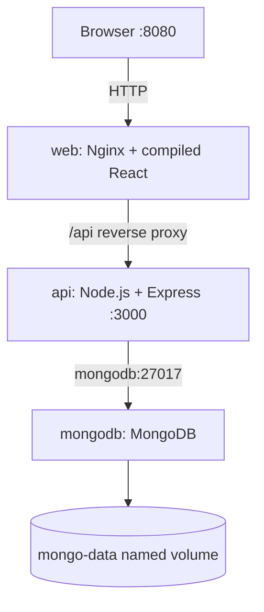

# Architecture and Request Flow

## Container-to-container networking

Compose creates a project network. The `web` container resolves the service name `api`. The `api` container resolves the service name `mongodb`. These names are **not** hostnames the user's browser can resolve. Host port 8080 maps to container port 80; host port 3000 maps to API port 3000 for classroom testing. MongoDB is not published to the host.

## Dockerfiles

- `frontend/Dockerfile`: multi-stage build; compile React with Node, serve static assets with Nginx.
- `backend/Dockerfile`: install Express and MongoDB driver, then start Node API as a non-root user.
- `mongodb/Dockerfile`: start from official MongoDB image and copy initialization seed JavaScript.

## Persistent data

`mongo-data:/data/db` is a named volume. Removing a MongoDB **container** does not automatically remove the **volume**. The initialization script executes only when MongoDB first initializes an empty data directory.

## Data flow example

1. Student opens the dashboard in a browser.
2. React requests `/api/customers`.
3. Nginx forwards that request to `http://api:3000/api/customers`.
4. Express queries `foxinsurance.customers` on MongoDB using the hostname `mongodb`.
5. Express returns JSON to Nginx, which returns it to the browser.
6. React displays the records.
